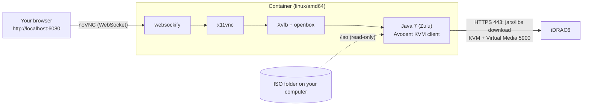

# iDRAC6-Viewer

**Dell iDRAC6 Virtual Console and Virtual Media in a container — no Java 7 on your machine, no browser plugins, no JNLP.**

[](https://github.com/didaktikm/iDRAC6-Viewer/actions/workflows/docker.yml)
[](https://github.com/didaktikm/iDRAC6-Viewer/pkgs/container/idrac6-viewer)
[](LICENSE)

🇬🇧 English · [🇷🇺 Русский](README.ru.md)

---

## Table of contents

- [Why](#why)
- [Features](#features)
- [How it works](#how-it-works)
- [Requirements](#requirements)
- [Quick start](#quick-start)
- [Configuration](#configuration)
- [Installing an OS with Virtual Media](#installing-an-os-with-virtual-media)
- [Networking](#networking)
- [Security](#security)
- [Troubleshooting](#troubleshooting)
- [Building from source](#building-from-source)
- [CI/CD and releases](#cicd-and-releases)
- [Repository layout](#repository-layout)
- [FAQ](#faq)
- [License, disclaimer, credits](#license-disclaimer-credits)

## Why

The iDRAC6 web UI starts the Virtual Console as a Java Web Start (JNLP) application. Modern browsers have dropped
Java plugins, `javaws` was removed from current JDKs, the client's certificate/signature checks fail on modern
Java, and the old TLS that iDRAC6 speaks (TLS 1.0, 1024-bit or weaker DH) is rejected by modern OpenSSL and Java.
Keeping a Windows VM with Java 7 around just to install an operating system is painful.

This project packages everything that is needed into one container. You run one `docker run` command and get the
remote console **in your browser**, with **Virtual Media** (mount an ISO from your computer to the server).

## Features

- Virtual Console (keyboard, video, mouse) in any browser via noVNC — `http://localhost:6080`
- Virtual Media: map an ISO/IMG from a folder on your computer as a virtual CD/DVD
- Nothing proprietary is redistributed: the KVM client and its native libraries are downloaded **from your own
  iDRAC** at start-up, so versions always match the firmware
- Legacy TLS (TLS 1.0, weak DH) is enabled **only inside the container**, only for this client
- Plain `docker run` with flags/environment variables, interactive prompt for the password, `--password-file` support
- Prebuilt image in GitHub Container Registry (built by GitHub Actions), `linux/amd64`
- Works on Apple Silicon through Docker Desktop's x86_64 emulation (Rosetta/QEMU)

## How it works



1. The entrypoint downloads `avctKVM.jar`, `avctKVMIOLinux64.jar` and `avctVMLinux64.jar` from
   `https://<idrac>:<https-port>/software/` (exactly what the JNLP file references) and unpacks the native
   libraries (`.so`) from the last two.
2. It starts a virtual X display (Xvfb), a tiny window manager (openbox), a VNC server (x11vnc) and noVNC.
3. It launches the Avocent client (`com.avocent.idrac.kvm.Main`) on Zulu 7 with the arguments the JNLP would pass
   (`ip`, `kmport`, `vport`, `user`, `passwd`, `apcp=1`, `version=2`, `vmprivilege=true`).
4. You see the client's window in the browser. *Virtual Media → Map CD/DVD* opens a file dialog that starts in `/iso`.

## Requirements

- **Server:** Dell iDRAC6 with an **Enterprise** license (Virtual Console and Virtual Media are not available in
  Express). Developed and verified on a PowerEdge R410, iDRAC6 firmware 2.85.
- **Network:** your machine must reach the iDRAC on the web port (443 by default) **and** the KVM port (5900 by default).
- **Docker:** Docker Desktop (macOS/Windows) or Docker Engine (Linux).
  - Apple Silicon: enable *Settings → General → Use Rosetta for x86_64/amd64 emulation* (faster than QEMU).
  - Windows: should work with Docker Desktop (WSL 2) but is not tested by the author.
- The **iDRAC password** for the user you log in with (the same as in the web UI).

## Quick start

```bash
docker run --rm -it --init --platform linux/amd64 \
  -p 127.0.0.1:6080:6080 \
  -v "$HOME/isos:/iso:ro" \
  -e IDRAC_HOST=idrac.example.com \
  ghcr.io/didaktikm/idrac6-viewer:latest
```

> Replace `idrac.example.com` with the address of your iDRAC. If you run your own fork, use your account instead of
> `didaktikm` in the image name.

The container asks for the password, downloads the client from the iDRAC and prints
`Open in your browser: http://localhost:6080/vnc.html?autoconnect=1&resize=scale`. Open that URL.

Same thing with flags instead of environment variables:

```bash
docker run --rm -it --init --platform linux/amd64 \
  -p 127.0.0.1:6080:6080 -v "$HOME/isos:/iso:ro" \
  ghcr.io/didaktikm/idrac6-viewer:latest \
  --host idrac.example.com --https-port 8443 --kvm-port 5900 --user root
```

Docker Compose, if you prefer a file:

```yaml
services:
  idrac:
    image: ghcr.io/didaktikm/idrac6-viewer:latest
    platform: linux/amd64
    init: true
    stdin_open: true
    tty: true
    environment:
      IDRAC_HOST: idrac.example.com
      IDRAC_HTTPS_PORT: 443
      IDRAC_KVM_PORT: 5900
    ports: ["127.0.0.1:6080:6080"]
    volumes: ["./isos:/iso:ro"]
```

Run it with `docker compose run --rm --service-ports idrac` (so the password prompt gets a terminal).

Not interactive (scripts)? Use `-e IDRAC_PASSWORD=...` or, better, a file:
`-v "$HOME/.idrac-pass:/run/idrac-pass:ro" -e IDRAC_PASSWORD_FILE=/run/idrac-pass`.

## Configuration

Every option exists as an environment variable and as a flag. Flags win over environment variables.

| Flag | Environment variable | Default | Description |
|---|---|---|---|
| `--host HOST` | `IDRAC_HOST` | — (prompted on a TTY) | iDRAC address (IP or DNS name) |
| `--https-port PORT` | `IDRAC_HTTPS_PORT` | `443` | iDRAC web port (used to download the client) |
| `--kvm-port PORT` | `IDRAC_KVM_PORT` | `5900` | iDRAC KVM / Virtual Media port |
| `--user USER` | `IDRAC_USER` | `root` | iDRAC user |
| `--password PASS` | `IDRAC_PASSWORD` | — (prompted on a TTY) | iDRAC password. Visible in `docker inspect` / process list; prefer the prompt or a file |
| `--password-file FILE` | `IDRAC_PASSWORD_FILE` | — | Read the password from the first line of FILE |
| `--resolution WxHxD` | `RESOLUTION` | `1280x800x24` | Virtual screen size and colour depth |
| — | `JAVA_OPTS` | `-Xmx256m` | Extra JVM options |
| `--selftest` | — | — | Check that all tools are present and exit |
| `--version`, `-h/--help` | — | — | Print version / help |

Ports and volumes:

| What | Value |
|---|---|
| noVNC (browser) | container `6080` → publish it on **localhost only**: `-p 127.0.0.1:6080:6080` |
| ISO folder | mount at `/iso` (read-only): `-v /path/to/isos:/iso:ro` |

## Installing an OS with Virtual Media

1. Put the installer ISO into the folder you mount at `/iso`.
2. In the client window: **Virtual Media → Map CD/DVD**, choose the file from `/iso` and confirm.
3. Reboot the server (power control in the iDRAC web UI or the client), press **F11** (Boot Manager) and
   choose the virtual CD/DVD. On a UEFI server with *No boot device available*, use F11 → Boot Manager, or switch
   *Boot Mode* to BIOS in System Setup.
4. When you are done: **Virtual Media → Unmap**, make sure the server boots from its disk, and change the iDRAC
   root password if you ever typed it somewhere it should not be.

**Tip — prefer a network installer.** Virtual Media is slow (USB CD-ROM emulation over your network) and, in the
author's setup, a full Debian netinst/DVD failed at *Install the base system* with
`Warning: file:///cdrom/pool/main/.../*.deb was corrupt` (the same package on two different ISOs, checksums of the
ISO files were correct). Booting the tiny network image reads almost nothing through Virtual Media and downloads
packages over the server's own network connection:

```
http://ftp.debian.org/debian/dists/trixie/main/installer-amd64/current/images/netboot/mini.iso
```

This needs outbound internet access from the server itself.

## Networking

The machine running the container needs a direct TCP path to the iDRAC on **two** ports:

| Port | Purpose |
|---|---|
| web (443 by default) | downloading the KVM client and libraries |
| KVM (5900 by default) | video, keyboard, mouse and Virtual Media |

If you reach the iDRAC through port forwarding (e.g. on a router) forward both ports and pass the external ports with
`--https-port` / `--kvm-port`.

**Asymmetric routing breaks the KVM connection.** If your outgoing traffic leaves through a different path/IP than the
one the iDRAC answers to (typically a full-tunnel VPN), the client shows `Connection failed`; on a forwarding router
you will see the connection stuck in `SYN_RECV` in conntrack. Disconnect the VPN or exclude the iDRAC address from
the tunnel.

## Security

- **iDRAC6 is end-of-life.** It speaks TLS 1.0 and weak Diffie-Hellman. Do not expose it to the internet. Use a VPN
  (e.g. WireGuard) or a trusted LAN. The TLS relaxations here are confined to the container, but they do mean the
  connection to the iDRAC is not strongly protected.
- **noVNC has no authentication.** Anybody who can reach port 6080 gets the console of your server. Publish it only
  on localhost (`-p 127.0.0.1:6080:6080`) and never on `0.0.0.0`.
- The password is passed to the Java client as a command-line argument (this is how the JNLP does it), so it is
  visible inside the container's process list. Treat the container as sensitive while it runs.
- `--password` / `IDRAC_PASSWORD` end up in your shell history or `docker inspect`. Prefer the interactive prompt or
  `--password-file`.
- The jars and `.so` files are downloaded over HTTPS **without certificate verification** (iDRAC6 uses a
  self-signed certificate) and then executed. Only point the container at an iDRAC you trust.
- The container runs as root and Java 7 (Zulu 7u352) is old. It is an isolated, short-lived tool: do not reuse the
  image for anything else.

## Troubleshooting

| Symptom | Cause / fix |
|---|---|
| `Port <host>:<port> is unreachable` | No path to the iDRAC. Check port forwarding, firewall, VPN; try `nc -vz <host> 443` and `nc -vz <host> 5900`. |
| `Could not download .../software/avctKVM.jar` | Wrong web port or an unrelated service answers there. Open `https://<host>:<port>/` in a browser and use that port in `--https-port`. |
| `curl: ... dh key too small` | You are not using this image's curl options (e.g. downloading the jars by hand). The image handles it; if you see it inside the container, open an issue with the full log. |
| Client window says `Connection failed` | (1) wrong password — use the web-UI password for that user; (2) asymmetric route / VPN (see [Networking](#networking)); (3) KVM port not forwarded. |
| *The Virtual Media program will close… native library cannot be loaded* | The `.so` list printed at start-up shows what the Linux jars contain. Open an issue with that output and the exact error. |
| *No boot device available* after mapping the ISO | Press **F11** and pick the virtual CD/DVD in Boot Manager, or switch Boot Mode (UEFI ↔ BIOS) in System Setup. |
| Debian installer: `…deb was corrupt` while installing the base system | Use the network installer `mini.iso` (see above). |
| Ctrl+Alt+Del / some F-keys do not reach the server | The browser captures them. Use the client's **Macros** menu (it has a Ctrl-Alt-Del entry) or its on-screen keyboard. |
| Very slow start or laggy console on an Apple-silicon Mac | The image is x86_64 and runs under emulation. Enable Rosetta in Docker Desktop, lower `--resolution`. |
| `docker build` fails with `unexpected EOF` while fetching Debian packages | Some ISPs cut downloads from `deb.debian.org`. Use the prebuilt image, or build with `--build-arg DEB_MIRROR=mirror.yandex.ru`. |
| Port 6080 already in use | `-p 127.0.0.1:6081:6080` and open `http://localhost:6081/vnc.html?autoconnect=1&resize=scale`. |

## Building from source

```bash
git clone https://github.com/didaktikm/iDRAC6-Viewer.git
cd iDRAC6-Viewer
docker build --platform linux/amd64 -t idrac6-viewer:local .
# if deb.debian.org is cut off by your ISP:
docker build --platform linux/amd64 --build-arg DEB_MIRROR=mirror.yandex.ru -t idrac6-viewer:local .
```

Run it like the published image (`idrac6-viewer:local` instead of `ghcr.io/…`). Build arguments:

| Argument | Default | Meaning |
|---|---|---|
| `DEB_MIRROR` | `mirror.yandex.ru` | Debian mirror for `apt` (CI uses `deb.debian.org`) |
| `ZULU7_URL` | Zulu 7u352 `linux_x64` tarball | Where to download the JDK from |
| `VERSION` | `dev` | Shown by `--version` |

There is also an optional helper that benchmarks several mirrors, asks for host/ports/user/ISO folder (defaults from
`.env`) and starts everything with Docker Compose: `cp .env.example .env && ./scripts/local.sh`
(`./scripts/local.sh --help`).

## CI/CD and releases

[`.github/workflows/docker.yml`](.github/workflows/docker.yml) runs on every push to `main`, on `v*` tags, on pull
requests and manually:

1. **lint** — `shellcheck` + `bash -n` for `entrypoint.sh` and `scripts/*.sh`.
2. **build** — builds the image with Buildx (`linux/amd64`, GitHub Actions cache), then smoke-tests it:
   `--version`, `--help`, `--selftest` (all tools and Java present) and "refuses to start without a host".
3. **push** — on pushes (not on pull requests) publishes to `ghcr.io/<owner>/<repo>`:

| Event | Tags |
|---|---|
| push to `main` | `latest`, `main`, `sha-<short>` |
| tag `v1.2.3` | `1.2.3`, `1.2`, `sha-<short>` |

Release: `git tag v1.0.0 && git push origin v1.0.0`.

> **First publish:** GitHub usually creates a new container package as *private*. Open the repository's *Packages →
> idrac6-viewer → Package settings* and set the visibility to **Public** once, otherwise `docker pull` needs a login.

The workflow needs no secrets — it uses the built-in `GITHUB_TOKEN` with `packages: write`.

## Repository layout

```
.
├── Dockerfile               # two-stage build: Zulu 7 → JRE only; Debian + Xvfb/x11vnc/noVNC
├── entrypoint.sh            # flags/env, downloads the client from the iDRAC, starts the stack
├── idrac.java.security      # re-enables TLS 1.0/1.1 for this JVM only
├── docker-compose.yml       # local build + run
├── scripts/local.sh         # optional: mirror benchmark, prompts, compose
├── .env.example             # defaults for scripts/local.sh
├── .github/workflows/docker.yml
├── README.md · README.ru.md
└── LICENSE
```

## FAQ

**Why Java 7, not a newer Java?**
The iDRAC6 client is a 2010-era application written for Java 6/7 and an old TLS stack. In the author's experience
Java 8 did not work (JNLP signature/permission errors), and `javaws` no longer exists in current JDKs.

**Why are the jars not in the repository?**
They belong to Dell/Avocent and differ between firmware versions. The container fetches the ones your iDRAC serves.

**Why `linux/amd64` only?**
The native libraries shipped by the iDRAC (`avctKVMIOLinux64`, `avctVMLinux64`) are x86_64. On ARM hosts the image
runs under emulation.

**Does it work with iDRAC7/8/9 or other Dell models?**
Not tested. Newer iDRACs have an HTML5 console. This project targets **iDRAC6**.

**Can I use it without Docker?**
Yes in principle (Java 7 + the same command line), but that is exactly the pain this project removes.

**Why does the server see a "USB CD-ROM" and not an ISO?**
That is how iDRAC Virtual Media works: the client emulates a USB optical drive and serves the sectors of your ISO.

## License, disclaimer, credits

Released under the [MIT License](LICENSE).

This project is **not affiliated with, endorsed by or sponsored by Dell Technologies**. "Dell", "PowerEdge" and
"iDRAC" are trademarks of their respective owners. The Avocent KVM client is downloaded from your own iDRAC and is
not part of this repository. Use at your own risk, only on hardware you are authorised to manage.

Built on [Azul Zulu](https://www.azul.com/downloads/?package=jdk) 7, [noVNC](https://github.com/novnc/noVNC),
[websockify](https://github.com/novnc/websockify), [x11vnc](https://github.com/LibVNC/x11vnc),
[Xvfb](https://www.x.org/) and [openbox](http://openbox.org/).
