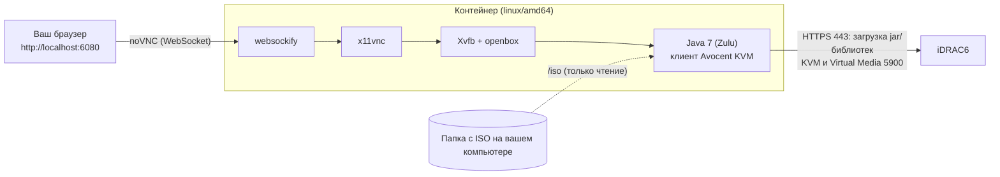

# iDRAC6-Viewer

**Виртуальная консоль и Virtual Media Dell iDRAC6 в контейнере — без Java 7 на вашем компьютере, без плагинов браузера и без JNLP.**

[](https://github.com/didaktikm/iDRAC6-Viewer/actions/workflows/docker.yml)
[](https://github.com/didaktikm/iDRAC6-Viewer/pkgs/container/idrac6-viewer)
[](LICENSE)

[🇬🇧 English](README.md) · 🇷🇺 Русский

---

## Содержание

- [Зачем это нужно](#зачем-это-нужно)
- [Возможности](#возможности)
- [Как это работает](#как-это-работает)
- [Требования](#требования)
- [Быстрый старт](#быстрый-старт)
- [Настройка](#настройка)
- [Установка ОС через Virtual Media](#установка-ос-через-virtual-media)
- [Сеть](#сеть)
- [Безопасность](#безопасность)
- [Решение проблем](#решение-проблем)
- [Сборка из исходников](#сборка-из-исходников)
- [CI/CD и релизы](#cicd-и-релизы)
- [Структура репозитория](#структура-репозитория)
- [FAQ](#faq)
- [Лицензия, отказ от ответственности, благодарности](#лицензия-отказ-от-ответственности-благодарности)

## Зачем это нужно

Веб-интерфейс iDRAC6 запускает виртуальную консоль как Java Web Start (JNLP) приложение. Современные браузеры
больше не поддерживают Java-плагины, `javaws` убрали из актуальных JDK, проверки подписи/прав клиента не проходят на
новой Java, а старый TLS, на котором говорит iDRAC6 (TLS 1.0, DH 1024 бит и слабее), отвергают современные OpenSSL и
Java. Держать виртуалку с Windows и Java 7 только ради установки операционной системы — мучение.

Этот проект упаковывает всё необходимое в один контейнер. Вы запускаете одну команду `docker run` и получаете
удалённую консоль **прямо в браузере** вместе с **Virtual Media** (ISO с вашего компьютера подключается к серверу).

## Возможности

- Виртуальная консоль (клавиатура, видео, мышь) в любом браузере через noVNC — `http://localhost:6080`
- Virtual Media: ISO/IMG из папки на вашем компьютере подключается как виртуальный CD/DVD
- Ничего проприетарного не распространяется: клиент KVM и его нативные библиотеки скачиваются **с вашего же iDRAC**
  при старте, поэтому версии всегда совпадают с прошивкой
- Старый TLS (TLS 1.0, слабый DH) включается **только внутри контейнера** и только для этого клиента
- Обычный `docker run` с флагами и переменными окружения, интерактивный запрос пароля, поддержка `--password-file`
- Готовый образ в GitHub Container Registry (собирается GitHub Actions), `linux/amd64`
- На Apple Silicon работает через эмуляцию x86_64 в Docker Desktop (Rosetta/QEMU)

## Как это работает



1. Entrypoint скачивает `avctKVM.jar`, `avctKVMIOLinux64.jar` и `avctVMLinux64.jar` с
   `https://<idrac>:<https-port>/software/` (ровно то, на что ссылается JNLP-файл) и распаковывает из двух последних
   нативные библиотеки (`.so`).
2. Поднимает виртуальный X-дисплей (Xvfb), лёгкий оконный менеджер (openbox), VNC-сервер (x11vnc) и noVNC.
3. Запускает клиент Avocent (`com.avocent.idrac.kvm.Main`) на Zulu 7 с теми аргументами, которые передал бы JNLP
   (`ip`, `kmport`, `vport`, `user`, `passwd`, `apcp=1`, `version=2`, `vmprivilege=true`).
4. Окно клиента видно в браузере. *Virtual Media → Map CD/DVD* открывает диалог выбора файла, который начинается в `/iso`.

## Требования

- **Сервер:** Dell iDRAC6 с лицензией **Enterprise** (виртуальная консоль и Virtual Media недоступны в Express).
  Разработано и проверено на PowerEdge R410, прошивка iDRAC6 2.85.
- **Сеть:** с вашего компьютера должен быть доступ к iDRAC по веб-порту (по умолчанию 443) **и** по порту KVM (по
  умолчанию 5900).
- **Docker:** Docker Desktop (macOS/Windows) или Docker Engine (Linux).
  - Apple Silicon: включите *Settings → General → Use Rosetta for x86_64/amd64 emulation* (быстрее, чем QEMU).
  - Windows: должно работать в Docker Desktop (WSL 2), но автор это не проверял.
- **Пароль iDRAC** пользователя, под которым вы входите (тот же, что в веб-интерфейсе).

## Быстрый старт

```bash
docker run --rm -it --init --platform linux/amd64 \
  -p 127.0.0.1:6080:6080 \
  -v "$HOME/isos:/iso:ro" \
  -e IDRAC_HOST=idrac.example.com \
  ghcr.io/didaktikm/idrac6-viewer:latest
```

> Замените `idrac.example.com` на адрес вашего iDRAC. Если вы используете свой форк, подставьте в имени образа свой
> аккаунт вместо `didaktikm`.

Контейнер спросит пароль, скачает клиент с iDRAC и напечатает
`Open in your browser: http://localhost:6080/vnc.html?autoconnect=1&resize=scale`. Откройте этот адрес.

То же самое флагами вместо переменных окружения:

```bash
docker run --rm -it --init --platform linux/amd64 \
  -p 127.0.0.1:6080:6080 -v "$HOME/isos:/iso:ro" \
  ghcr.io/didaktikm/idrac6-viewer:latest \
  --host idrac.example.com --https-port 8443 --kvm-port 5900 --user root
```

Docker Compose, если удобнее файл:

```yaml
services:
  idrac:
    image: ghcr.io/didaktikm/idrac6-viewer:latest
    platform: linux/amd64
    init: true
    stdin_open: true
    tty: true
    environment:
      IDRAC_HOST: idrac.example.com
      IDRAC_HTTPS_PORT: 443
      IDRAC_KVM_PORT: 5900
    ports: ["127.0.0.1:6080:6080"]
    volumes: ["./isos:/iso:ro"]
```

Запуск: `docker compose run --rm --service-ports idrac` (чтобы запрос пароля получил терминал).

Нужен запуск без диалога (скрипты)? Используйте `-e IDRAC_PASSWORD=...` или, лучше, файл:
`-v "$HOME/.idrac-pass:/run/idrac-pass:ro" -e IDRAC_PASSWORD_FILE=/run/idrac-pass`.

## Настройка

Каждый параметр доступен и как переменная окружения, и как флаг. Флаги приоритетнее переменных окружения.

| Флаг | Переменная окружения | По умолчанию | Описание |
|---|---|---|---|
| `--host HOST` | `IDRAC_HOST` | — (спросит в TTY) | Адрес iDRAC (IP или DNS-имя) |
| `--https-port PORT` | `IDRAC_HTTPS_PORT` | `443` | Веб-порт iDRAC (для загрузки клиента) |
| `--kvm-port PORT` | `IDRAC_KVM_PORT` | `5900` | Порт KVM / Virtual Media |
| `--user USER` | `IDRAC_USER` | `root` | Пользователь iDRAC |
| `--password PASS` | `IDRAC_PASSWORD` | — (спросит в TTY) | Пароль iDRAC. Виден в `docker inspect` и списке процессов; лучше диалог или файл |
| `--password-file FILE` | `IDRAC_PASSWORD_FILE` | — | Прочитать пароль из первой строки файла |
| `--resolution WxHxD` | `RESOLUTION` | `1280x800x24` | Размер виртуального экрана и глубина цвета |
| — | `JAVA_OPTS` | `-Xmx256m` | Дополнительные параметры JVM |
| `--selftest` | — | — | Проверить наличие всех инструментов и выйти |
| `--version`, `-h/--help` | — | — | Версия / справка |

Порты и тома:

| Что | Значение |
|---|---|
| noVNC (браузер) | порт контейнера `6080` → публикуйте **только на localhost**: `-p 127.0.0.1:6080:6080` |
| Папка с ISO | монтируется в `/iso` (только чтение): `-v /путь/к/isos:/iso:ro` |

## Установка ОС через Virtual Media

1. Положите ISO установщика в папку, которую монтируете в `/iso`.
2. В окне клиента: **Virtual Media → Map CD/DVD**, выберите файл из `/iso` и подтвердите.
3. Перезагрузите сервер (управление питанием в веб-интерфейсе iDRAC или в клиенте), нажмите **F11** (Boot Manager) и
   выберите виртуальный CD/DVD. На UEFI-сервере при *No boot device available* используйте F11 → Boot Manager или
   переключите *Boot Mode* на BIOS в System Setup.
4. Когда закончите: **Virtual Media → Unmap**, убедитесь, что сервер грузится с диска, и смените пароль root в iDRAC,
   если вводили его там, где не следовало.

**Совет — лучше сетевой установщик.** Virtual Media медленный (эмуляция USB CD-ROM через вашу сеть), и в сборке автора
полный Debian netinst/DVD падал на шаге *Install the base system* с
`Warning: file:///cdrom/pool/main/.../*.deb was corrupt` (один и тот же пакет на двух разных ISO, контрольные суммы
самих ISO были верными). Крошечный сетевой образ почти ничего не читает через Virtual Media, а пакеты скачивает по
собственному сетевому подключению сервера:

```
http://ftp.debian.org/debian/dists/trixie/main/installer-amd64/current/images/netboot/mini.iso
```

Для этого у самого сервера должен быть исходящий доступ в интернет.

## Сеть

С компьютера, где запущен контейнер, до iDRAC нужен прямой TCP-путь по **двум** портам:

| Порт | Для чего |
|---|---|
| веб (по умолчанию 443) | загрузка клиента KVM и библиотек |
| KVM (по умолчанию 5900) | видео, клавиатура, мышь и Virtual Media |

Если вы ходите в iDRAC через проброс портов (например, на роутере), пробросьте оба порта и передайте внешние порты
через `--https-port` / `--kvm-port`.

**Асимметричная маршрутизация ломает KVM-соединение.** Если ваш исходящий трафик уходит другим путём/с другого IP,
чем тот, на который отвечает iDRAC (обычно это VPN с полным туннелем), клиент пишет `Connection failed`, а на
роутере с пробросом соединение зависает в `SYN_RECV` в conntrack. Отключите VPN или исключите адрес iDRAC из туннеля.

## Безопасность

- **iDRAC6 снят с поддержки.** Он говорит на TLS 1.0 и слабом Диффи-Хеллмане. Не выставляйте его в интернет.
  Используйте VPN (например, WireGuard) или доверенную локальную сеть. Ослабление TLS ограничено контейнером, но
  соединение с iDRAC от этого не становится надёжно защищённым.
- **У noVNC нет аутентификации.** Любой, кто достучится до порта 6080, получит консоль вашего сервера. Публикуйте его
  только на localhost (`-p 127.0.0.1:6080:6080`) и никогда на `0.0.0.0`.
- Пароль передаётся Java-клиенту аргументом командной строки (так делает и JNLP), поэтому он виден в списке процессов
  внутри контейнера. Пока контейнер работает, считайте его чувствительным.
- `--password` / `IDRAC_PASSWORD` попадают в историю шелла или `docker inspect`. Предпочитайте интерактивный запрос
  или `--password-file`.
- Jar-файлы и `.so` скачиваются по HTTPS **без проверки сертификата** (у iDRAC6 самоподписанный сертификат) и затем
  исполняются. Направляйте контейнер только на iDRAC, которому доверяете.
- Контейнер работает от root, а Java 7 (Zulu 7u352) стара. Это изолированный короткоживущий инструмент: не
  используйте образ ни для чего другого.

## Решение проблем

| Симптом | Причина / решение |
|---|---|
| `Port <host>:<port> is unreachable` | Нет пути до iDRAC. Проверьте проброс портов, файрвол, VPN; попробуйте `nc -vz <host> 443` и `nc -vz <host> 5900`. |
| `Could not download .../software/avctKVM.jar` | Неверный веб-порт или там отвечает другой сервис. Откройте `https://<host>:<порт>/` в браузере и передайте этот порт в `--https-port`. |
| `curl: ... dh key too small` | Вы не используете параметры curl из образа (например, качаете jar вручную). Образ это обрабатывает; если видите ошибку внутри контейнера — создайте issue с полным логом. |
| В окне клиента `Connection failed` | (1) неверный пароль — нужен пароль веб-интерфейса этого пользователя; (2) асимметричный маршрут / VPN (см. [Сеть](#сеть)); (3) порт KVM не проброшен. |
| *The Virtual Media program will close… native library cannot be loaded* | Список `.so`, который печатается при старте, показывает содержимое Linux-jar'ов. Создайте issue с этим выводом и точным текстом ошибки. |
| *No boot device available* после подключения ISO | Нажмите **F11** и выберите виртуальный CD/DVD в Boot Manager либо переключите Boot Mode (UEFI ↔ BIOS) в System Setup. |
| Установщик Debian: `…deb was corrupt` при установке базовой системы | Используйте сетевой установщик `mini.iso` (см. выше). |
| Ctrl+Alt+Del и некоторые F-клавиши не доходят до сервера | Их перехватывает браузер. Используйте меню **Macros** клиента (там есть Ctrl-Alt-Del) или его экранную клавиатуру. |
| Очень долгий старт или лаги на Mac с Apple Silicon | Образ x86_64 и работает под эмуляцией. Включите Rosetta в Docker Desktop, уменьшите `--resolution`. |
| `docker build` падает с `unexpected EOF` при загрузке пакетов Debian | Некоторые провайдеры обрывают загрузки с `deb.debian.org`. Берите готовый образ или собирайте с `--build-arg DEB_MIRROR=mirror.yandex.ru`. |
| Порт 6080 занят | `-p 127.0.0.1:6081:6080` и откройте `http://localhost:6081/vnc.html?autoconnect=1&resize=scale`. |

## Сборка из исходников

```bash
git clone https://github.com/didaktikm/iDRAC6-Viewer.git
cd iDRAC6-Viewer
docker build --platform linux/amd64 -t idrac6-viewer:local .
# если провайдер режет deb.debian.org:
docker build --platform linux/amd64 --build-arg DEB_MIRROR=mirror.yandex.ru -t idrac6-viewer:local .
```

Запускайте так же, как опубликованный образ (`idrac6-viewer:local` вместо `ghcr.io/…`). Аргументы сборки:

| Аргумент | По умолчанию | Значение |
|---|---|---|
| `DEB_MIRROR` | `mirror.yandex.ru` | Зеркало Debian для `apt` (в CI — `deb.debian.org`) |
| `ZULU7_URL` | архив Zulu 7u352 `linux_x64` | Откуда качать JDK |
| `VERSION` | `dev` | Что покажет `--version` |

Есть и необязательный помощник: он замеряет несколько зеркал, спрашивает хост/порты/пользователя/папку с ISO (значения
по умолчанию берёт из `.env`) и запускает всё через Docker Compose: `cp .env.example .env && ./scripts/local.sh`
(`./scripts/local.sh --help`).

## CI/CD и релизы

[`.github/workflows/docker.yml`](.github/workflows/docker.yml) запускается при каждом push в `main`, на тегах `v*`, на
pull request'ах и вручную:

1. **lint** — `shellcheck` и `bash -n` для `entrypoint.sh` и `scripts/*.sh`.
2. **build** — собирает образ через Buildx (`linux/amd64`, кэш GitHub Actions), затем smoke-тест:
   `--version`, `--help`, `--selftest` (все инструменты и Java на месте) и «отказывается стартовать без хоста».
3. **push** — при push (не для pull request'ов) публикует в `ghcr.io/<owner>/<repo>`:

| Событие | Теги |
|---|---|
| push в `main` | `latest`, `main`, `sha-<short>` |
| тег `v1.2.3` | `1.2.3`, `1.2`, `sha-<short>` |

Релиз: `git tag v1.0.0 && git push origin v1.0.0`.

> **Первая публикация:** GitHub обычно создаёт новый пакет контейнера как *private*. Откройте в репозитории *Packages →
> idrac6-viewer → Package settings* и один раз переключите видимость на **Public**, иначе для `docker pull` нужен логин.

Секреты не нужны — используется встроенный `GITHUB_TOKEN` с правом `packages: write`.

## Структура репозитория

```
.
├── Dockerfile               # двухстадийная сборка: Zulu 7 → только JRE; Debian + Xvfb/x11vnc/noVNC
├── entrypoint.sh            # флаги/env, загрузка клиента с iDRAC, запуск стека
├── idrac.java.security      # возвращает TLS 1.0/1.1 только для этой JVM
├── docker-compose.yml       # локальная сборка и запуск
├── scripts/local.sh         # необязательно: замер зеркал, вопросы, compose
├── .env.example             # значения по умолчанию для scripts/local.sh
├── .github/workflows/docker.yml
├── README.md · README.ru.md
└── LICENSE
```

## FAQ

**Почему Java 7, а не новее?**
Клиент iDRAC6 — приложение 2010 года, написанное под Java 6/7 и старый TLS. По опыту автора Java 8 не подошла
(ошибки подписи/прав JNLP), а `javaws` в актуальных JDK больше нет.

**Почему jar-файлов нет в репозитории?**
Они принадлежат Dell/Avocent и отличаются в разных версиях прошивки. Контейнер берёт те, что отдаёт ваш iDRAC.

**Почему только `linux/amd64`?**
Нативные библиотеки, которые отдаёт iDRAC (`avctKVMIOLinux64`, `avctVMLinux64`), — x86_64. На ARM-хостах образ работает
под эмуляцией.

**Работает ли с iDRAC7/8/9 и другими моделями Dell?**
Не проверялось. У новых iDRAC есть HTML5-консоль. Проект рассчитан на **iDRAC6**.

**Можно ли без Docker?**
В принципе да (Java 7 и та же командная строка), но именно эту боль проект и убирает.

**Почему сервер видит «USB CD-ROM», а не ISO?**
Так устроен Virtual Media iDRAC: клиент эмулирует USB-привод и отдаёт секторы вашего ISO.

## Лицензия, отказ от ответственности, благодарности

Распространяется по [лицензии MIT](LICENSE).

Проект **не связан с Dell Technologies, не одобрен и не спонсируется ею**. «Dell», «PowerEdge» и «iDRAC» —
товарные знаки их владельцев. Клиент Avocent KVM скачивается с вашего собственного iDRAC и не входит в этот
репозиторий. Используйте на свой риск и только на оборудовании, которым вы вправе управлять.

Построено на [Azul Zulu](https://www.azul.com/downloads/?package=jdk) 7, [noVNC](https://github.com/novnc/noVNC),
[websockify](https://github.com/novnc/websockify), [x11vnc](https://github.com/LibVNC/x11vnc),
[Xvfb](https://www.x.org/) и [openbox](http://openbox.org/).
